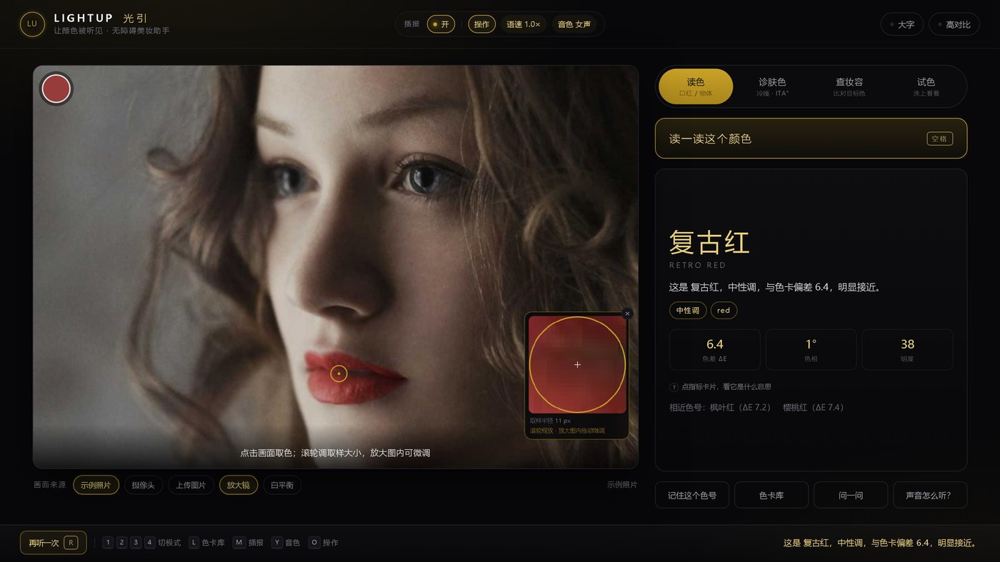
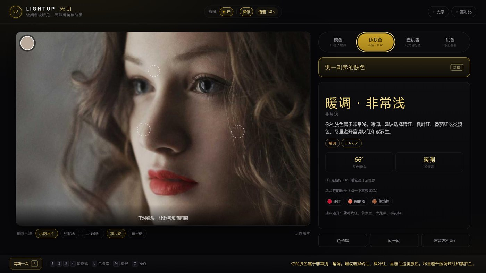
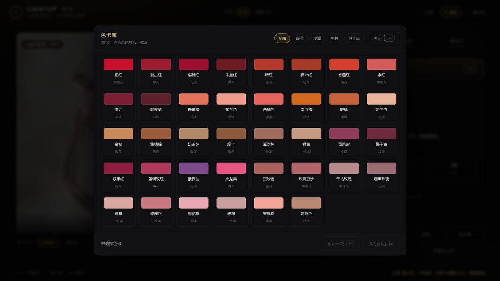
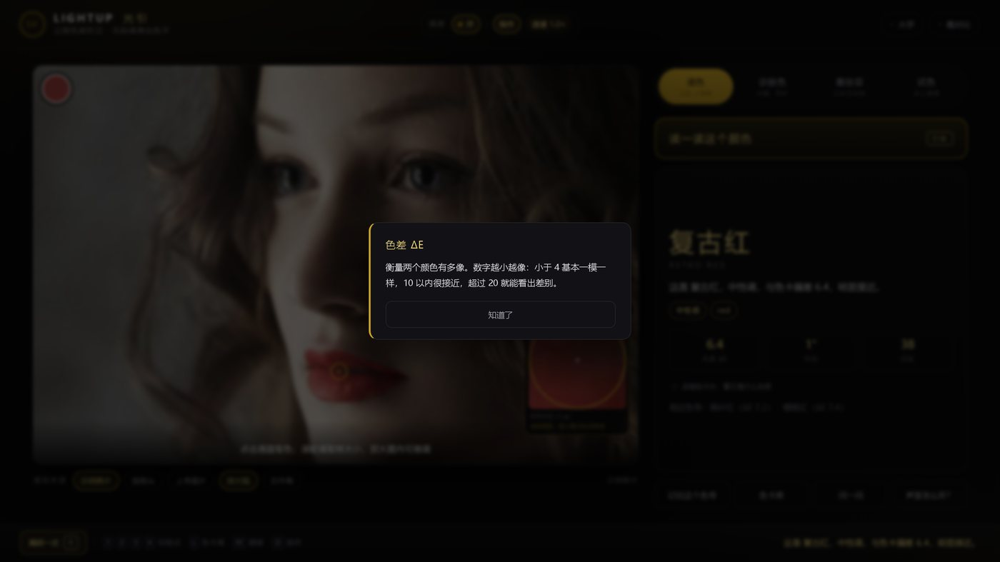
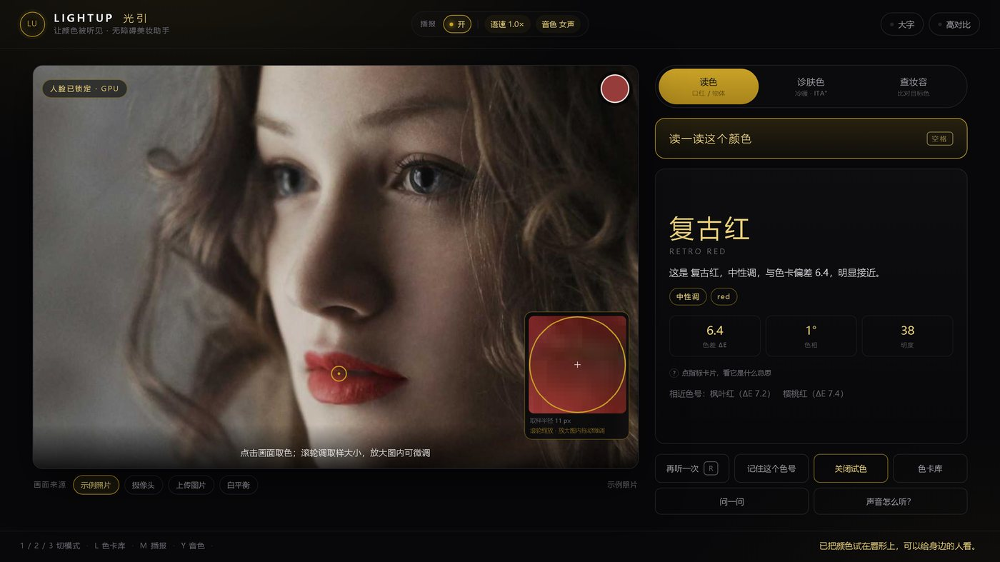
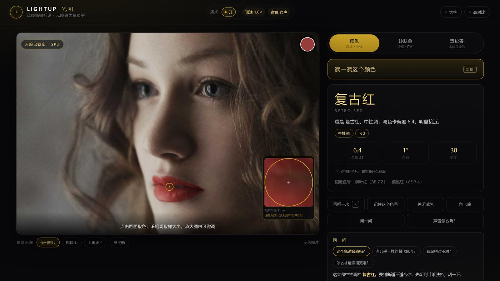
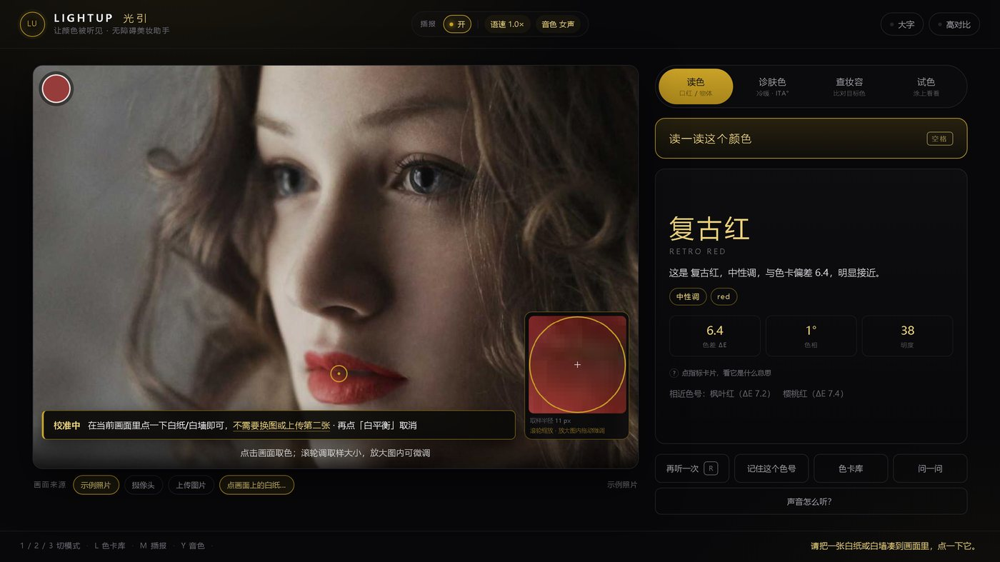
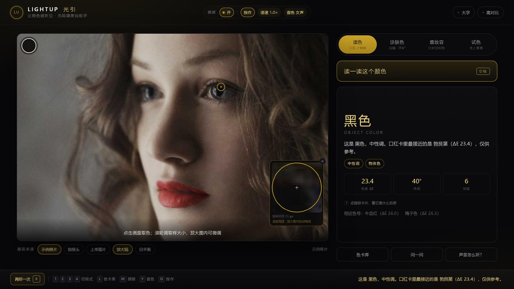

# LightUp 光引 · 无障碍美妆助手

> **把口红色号翻译成声音与语言**，让看不见的人也能独立选色、上妆、验妆。
>
> 参赛作品：欧莱雅「无界体验家」美妆科技赛 · 赛题 3 · **主题二（AI × 社会与企业责任）** · 初赛



---

## 1. 为什么做这个

视障女性买口红，只能问别人"这个红吗"；而"挺好看的"这四个字，回答不了"适不适合我、我涂对没有"。

我们做的不是又一个"描述世界"的 AI，而是**一套让颜色可被记住、可被复述的翻译标准**：

- **色相** → 五声音阶的两个八度（10 个音位）
- **冷暖** → 大三和弦 / 小三和弦
- **明度** → 音量与八度
- **饱和度** → 音色亮度

同一支口红，永远是同一段旋律。练几次，就能听辨色号。

---

## 2. 三个核心能力

| 模块 | 输入 | 输出 | 解决什么 |
|---|---|---|---|
| **读色** | 摄像头 / 上传图片，**点哪读哪** | 色号名 + 冷暖调 + 相近色 + 一段旋律 | 分不清色号 |
| **诊肤色** | 人脸三点（两颊 + 额头） | ITA° 肤色深浅 + 冷暖调 + **3 支推荐色号** + 建议避开 | 不知道自己适合什么 |
| **查妆容** | 嘴唇（自动定位） | 与"记住的目标色"的 ΔE 偏差 + 补涂建议 | 涂完不知道对不对 |
| **试色** | 选定色号 + 唇形 | 只替换唇部色相/饱和度、保留唇纹与高光，可快速换色 | 想看看"上嘴"是什么效果 |

四个模块串起来就是一条完整链路：**选色 → 试色 → 验妆**，全程不需要第三个人在场。

界面上**只标注当前模块真正用到的部位**：读色只显示取色圈，诊肤色只显示三点采样区，查妆容与试色只显示唇形——不会在测肤色时框住嘴唇。

| 读色 | 诊肤色 |
|---|---|
|  |  |

### 色卡库：把整本色卡「听」一遍

点结果区的「色卡库」（快捷键 `L`）打开：38 支色号按冷暖排布，可以按「暖调 / 冷调 / 中性 / 适合我」筛选。

- 点任意一支 → 立即播放它的旋律并播报色名
- 选中后可以「设为验妆目标」，回到查妆容直接比对
- 测过肤色后，「适合我」会自动只留合适的色号

对视障用户来说，这一步很关键：**不只是被动等系统匹配，而是能主动逛完整个色卡**。



---

### 指标说明：点一下就有解释

结果下方的每个数字都是可以点的：点开弹出通俗解释，按 `Esc` 或「知道了」关闭，焦点会回到原来的卡片。读屏软件会把解释念出来。

**指标数量按模块实际需要给，不为了整齐凑三个：**

| 模块 | 指标 | 为什么是这几个 |
|---|---|---|
| 读色 | 色差 / 色相 / 明度 | 分别回答"像不像、什么色、深浅如何" |
| 诊肤色 | 肤色深浅 / 冷暖调 | 判断配色只用这两个量；原始 b\*（黄度）是中间量，用户不需要看 |
| 查妆容 | 与目标色差 / 最接近的色号 | 验妆只关心"差多少、现在像哪支" |



---

## 3. 让"准"变成可验证的事

| 试色（给身边的人看） | 问一问（离线问答） |
|---|---|
|  |  |

**① 高光剔除 + Lab 空间取中位**
镜面反射不携带物体本色；sRGB 是 gamma 编码的，直接平均会被亮部带偏。

**② 白平衡校准**
点左下角「白平衡」→ 在当前画面里点一下白纸/白墙 → 之后所有读数按该基准校正。
**不需要上传第二张图**；若点到的区域带色或太暗会被拒绝。切换画面来源会自动重置。



**③ 取样半径可调 + 放大镜**
固定半径是精度杀手：半径 60px 时，瞳孔会被眼周皮肤平均成"深棕"；半径 11px 时才是"黑色"。
滚轮缩放（3–90px），右下放大镜实时显示取样区域，可拖动微调、方向键逐像素移动；**放大镜可以关闭**（右上角 ×、来源条「放大镜」或快捷键 `G`），避免遮挡画面。

**④ 唇部彩度加权**
膏体本色是彩度最高的那一簇。实测示例图唇部中位彩度仅 12.9，高彩度簇达 35——用中位数会被阴影拉灰。

**⑤ 不再"万物皆口红"**
色卡是口红卡，不是通用色卡。ΔE ≥ 12 时不套色号，改输出通用色名（黑/深灰/棕/米白/蓝/绿…），唇色只作"仅供参考"。

| 瞳孔（半径 11px） | 瞳孔（半径 60px） |
|---|---|
|  | 被眼周皮肤平均 → 深棕 |

### 量化结果（`node app/_dev/eval-color.mjs` 可复现）

测试方法：13 支已知真值的色卡，模拟"暖色光源偏色 + 镜面高光 + 明暗渐变"。

| 指标 | 改造前 | 改造后 |
|---|---|---|
| 平均还原 ΔE | 6.67 | **3.46** |
| ΔE < 5 的比例 | 31% | **100%** |
| 色号命中率 | 31% | **92%** |

通用命名自检 **9/9 通过**（瞳孔=黑、白纸=白、木桌=棕、天空=蓝…）。

---

## 4. 快速开始

需要 Node.js ≥ 18。

```bash
cd app
npm install
node serve.mjs
```

浏览器打开 <http://127.0.0.1:8765>。

> **首屏很快，模型按需加载**：首次打开只下载约 55 KB（页面 + 示例图），人脸模型（约 16 MB）在你切到「诊肤色 / 查妆容 / 试色」或开启摄像头时才在后台加载。所以网络慢时页面也不会白屏，读色功能始终可用。

Windows 用户也可以直接双击 `app/启动Demo.bat`（自动装依赖、起服务、开浏览器）。

> ⚠️ 必须通过本地服务器访问。直接双击 `index.html` 会被浏览器的模块/WASM 安全策略拦下（页面会给出提示）。

### 画面来源三选一

打开页面时**默认就是「示例照片」**，不需要先授权摄像头，第一眼就能看到完整流程。

- **示例照片**（默认）：内置一张，录屏 / 无摄像头时用
- **摄像头**：实时取色
- **上传图片**：点按钮或按 `U`，也可**直接把图片拖进画面**

### 键盘

| 键 | 作用 |
|---|---|
| `空格` | 读色 |
| `1` `2` `3` `4` | 读色 / 诊肤色 / 查妆容 / 试色 |
| `R` | 重听 |
| `←` `→` `↑` `↓` | 微调取色点（`Shift` 加速） |
| 滚轮 | 调整取样半径 |
| `U` | 上传图片 |
| `M` / `T` / `O` | 播报开关 / 语速 / 操作提示 |
| `G` | 显示 / 隐藏放大镜 |
| `B` / `C` | 大字 / 高对比 |

---

## 5. 响应式

桌面端 1024–2560 宽（含 1366×768、1280×720 这类小笔记本）**都不会出现横向溢出或滚动条**，舞台高度跟随视口自动收放；窄屏（平板/手机）顶栏自动折成多行、面板单列堆叠，手机上放大镜默认收起以免挡脸。

自检脚本：`node app/_dev/audit-layout.mjs`（9 个分辨率，检查溢出/元素重叠）。

## 6. 无障碍设计

- 纯键盘可完成全部操作，焦点可见
- 语音 + 字幕双通道（结果区 `aria-live`）
- 大字模式、高对比模式
- **播报开关 + 操作提示开关 + 语速 0.8–1.4×**：可以把"按钮与切换的提示音"单独关掉，只留颜色与妆容的结果播报
- 全部计算在本机完成，画面不出设备

---

## 7. 技术实现

全部在浏览器本地完成，不依赖后端与云服务：

- **人脸与唇部定位**：478 点人脸网格，WASM 本地推理（模型 3.6 MB，离线可用）
- **色彩计算**：sRGB → CIELAB、CIEDE2000 色差、ITA° 肤色角
- **取色管线**：高光剔除 → 白平衡校正 → Lab 中位 →（唇部）彩度加权
- **声音**：Web Audio 合成。色相 → 五声音阶，冷暖 → 三和弦性质，明度 → 音量，饱和 → 音色
- **语音**：Web Speech API，分句播报、可打断；语速 0.8–1.4 倍；内容播报与操作提示分成两路，可分别开关
- **问答**：基于当前状态的规则推理，纯离线，不调用任何 API

第三方组件的许可证声明见 [LICENSE](LICENSE) 末尾。

## 8. 目录

```
.
├─ app/
│  ├─ index.html          界面
│  ├─ styles.css          黑金视觉 + 无障碍模式
│  ├─ serve.mjs           零依赖静态服务器（正确的 .mjs / .wasm MIME）
│  ├─ src/
│  │  ├─ main.js          状态机、采样、渲染、调度
│  │  ├─ color.js         sRGB→Lab、CIEDE2000、ITA°、白平衡、稳健取色
│  │  ├─ shades.js        38 支色卡 + 肤色建议
│  │  ├─ audio.js         声化引擎（核心原创）
│  │  ├─ speech.js        语音播报（分句、可打断、语速）
│  │  └─ vision.js        MediaPipe 封装 + 人脸几何
│  ├─ vendor/             本地化的模型与 WASM（16.9 MB）
│  ├─ assets/             示例人像
│  └─ _dev/               自检、评估脚本（截图不入库）
├─ deck/                  初赛提案 PPT 与演示视频脚本
├─ docs/screenshots/      README 用截图
└─ README.md
```

---

## 9. 部署到 GitHub

```bash
git init
git add .
git commit -m "LightUp 光引：无障碍美妆助手（初赛）"
git branch -M main
git remote add origin https://github.com/<你的账号>/lightup.git
git push -u origin main
```

几点说明：

- **`app/vendor/` 约 17 MB**（模型 3.6 MB + WASM 12.9 MB），已随仓库提交，保证 clone 即跑，不需要联网下载模型。GitHub 单文件上限 100 MB，无需 LFS。
- 仓库仅保留运行所需的 `vision_wasm_internal.*`（SIMD 版本）。**需要支持 WASM SIMD 的浏览器**（2021 年后的 Chrome / Edge / Safari 均可）。
- `node_modules/`、`_dev/shots/`、`deck/render*/` 已在 `.gitignore` 中排除。
- 若要做在线演示，可部署到任意静态托管（GitHub Pages 需注意 `.wasm` 的 MIME，多数平台已正确支持）；`serve.mjs` 仅用于本地。

---

## 10. 已知限制

1. **声化需要学习**：色号与旋律的对应不是天生的，需要 3–5 次训练。我们把它设计成"可训练"，而不是回避。
2. **冷暖判定是启发式**：基于 b\*/a\* 比值标定，不等同于皮肤科结论。
3. **强逆光 / 彩色氛围灯**下，单点白平衡仍会偏；路线图第二期做多光源估计。
4. **色卡只有 38 支**，命中率 92% 的未命中部分主要是色卡本身过于接近（如奶茶棕 ↔ 奶茶色）。接品牌真实色号库后可解。
5. 示例人像来自公开图库，仅用于离线演示；对外视频建议用真人实拍。

---

## 11. 许可

代码 MIT。第三方组件见 [LICENSE](LICENSE) 末尾的声明（MediaPipe 为 Apache-2.0）。
